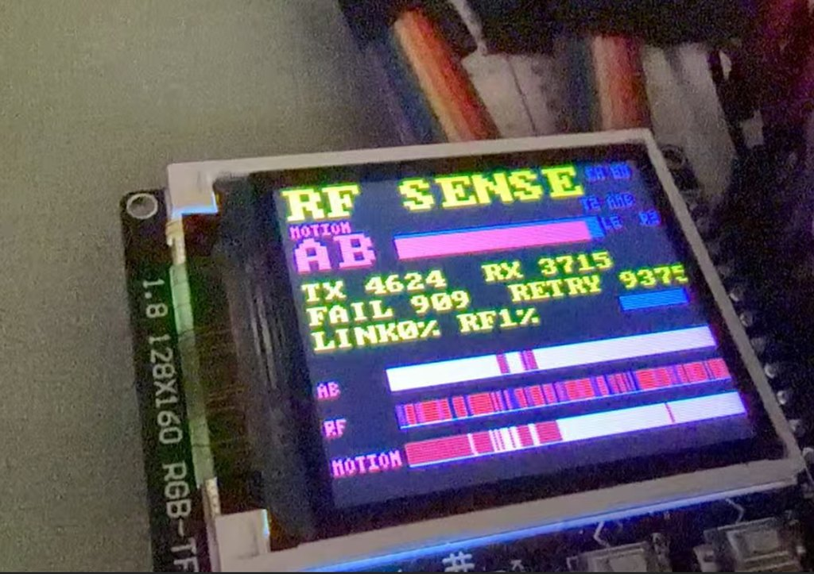

# ESP32-S3 + NRF24L01 RF 链路质量探测器

> **当前分支 `feat/2.4g-scan`**：固件已切换为 **2.4G 占用/噪声探测器**。
> 基础 AB 链路雷达在 `main` 分支。接线不变，扫描只需要一个 NRF（A 或 B）。

## 2.4G 探测器模式

- 扫 **2400–2525MHz**，1MHz 步进，共 126 个信道（NRF 的 0–125；下限 2400 是硬件极限）
- 每个信道采样 NRF 的 `RPD`（8 次），得到 0–100% 占用
- A+B 双模块分工扫，约 0.27 秒一帧
- 40KB 全屏帧缓冲，一次刷屏，不再分 16 条带
- 顶部 160 列占用柱，底部 21 行瀑布（2px/行）
- 频率轴固定为硬件全段 **2400–2525MHz（0–125）**，160 列完整铺满，不再自动缩放，瀑布可以持续累积
- `PEAK` 显示当前最强信道和数值
- K3 采一次安静环境的基线，之后显示相对基线的正偏差（`DELTA`）
- `RPD` 是 1-bit、约 -64dBm 门限，**不是 dBm，也不是频谱仪**
- 需要看具体带宽/波形时，用 `esp32-s3-st7735-sdr` 的 FFT/瀑布

| 按键 | 功能 |
|---|---|
| K1 | `ABS` / `DELTA` 切换 |
| K2 | 清空瀑布历史 |
| K3 | 采基线（自动进入 DELTA） |
| K4 | 暂停 / 继续 |
| 长按 K1 | 光标左移（选中频道后显示 `CUR 频点 占用`） |
| 长按 K2 | 光标右移 |
| 长按 K3 | 切换配色 |
| 长按 K4 | 重启 ESP32 |


用 2 或 3 个 NRF24L01 在 2.4GHz 上测量链路丢包/重传，检测有人/物体穿过
链路，显示在 ST7735 160x128 上。它是 **RF 运动探测器**，不是真雷达：
没有相位/TOF，不能测距、测速、成像。

> 独立固件，和 `esp32-s3-st7735-sdr` 的 SDR 固件分开。NRF 和 SDR 都占用
> 2.4GHz，不能同时跑；本固件不初始化 WiFi/PHY。



*RF SENSE 实机：AB 链路，TX/RX/FAIL/RETRY，LINK/RF 统计，底部 AB/RF/MOTION 三条历史。*
  照片里 LINK 0% 是当时 A 模块接触不良，正常时 LINK 接近 100%。*

## 接线

ST7735 和按键沿用 SDR 的接法：

| ST7735 | ESP32-S3 |
|---|---|
| SCK | GPIO12 |
| MOSI | GPIO11 |
| CS | GPIO10 |
| DC | GPIO9 |
| RST | GPIO8 |
| BL | GPIO7 |
| VCC/GND | 3V3/GND |

| 按键 | ESP32-S3 |
|---|---|
| K1 / UP | GPIO4 |
| K2 / DOWN | GPIO5 |
| K3 / OK | GPIO6 |
| K4 / BACK | GPIO14 |

NRF24L01 使用**独立 SPI3**，不要和屏幕的 SPI2 混在一起：

| NRF 信号 | 模块 A | 模块 B | 模块 C |
|---|---|---|---|
| VCC | 3V3 | 3V3 | 3V3 |
| GND | GND | GND | GND |
| SCK | GPIO13 | GPIO13 | GPIO13 |
| MOSI | GPIO15 | GPIO15 | GPIO15 |
| MISO | GPIO16 | GPIO16 | GPIO16 |
| CSN | GPIO17 | GPIO18 | GPIO21 |
| CE | GPIO38 | GPIO39 | GPIO40 |
| IRQ | 不接 | 不接 | 不接 |

- 只接 2 个模块时，接 A、B，C 的 CSN/CE 不用接；固件会自动只做 AB 链路。
- 模块引脚以丝印标签为准（GND/VCC/CE/CSN/SCK/MOSI/MISO/IRQ），不要按图片编号。
- 每个模块 VCC/GND 并 **10µF + 100nF**，尽量靠近模块。
- 必须 3.3V，不要接 5V。
- 三根天线尽量拉开 10–20cm，不要并排贴在一起。
- GPIO39/40 是 JTAG 引脚；不调试 JTAG 时当普通 GPIO 用没问题。

## 构建

需要 ESP-IDF v5.4.2：

```bash
cd esp32-s3-nrf-radar
idf.py -B build -DIDF_TARGET=esp32s3 build
idf.py -B build -p /dev/cu.usbserial-XXXX flash
```

组件管理器已关闭，`esp_lcd_st7735` 和所有依赖都在 `components/` 内，编译不需要联网。

## 操作

| 按键 | 功能 |
|---|---|
| K1 | 通道 +1（70..90，默认 80 = 2480MHz） |
| K2 | 通道 −1 |
| K3 短按 | 重新校准基线 |
| K3 长按（≥700ms） | 切换下一套配色（T1..T10） |
| K4 | 暂停 / 继续 |

- 上电后先做约 20 帧基线校准，屏幕显示 `CALIBRATING`。
- 三条链路 AB / AC / BC 轮流测量；哪条链路被扰动，对应行会掉质量/丢包。
- 底部历史条显示最近约 160 帧的链路质量。
- 任一链路明显偏离基线 → `MOTION`。
- 没有检测到 NRF 模块 → `NO NRF`。

## 界面数据

- 每条链路：质量条、`L` 丢包率、`R` 重传数
- 底部历史：最近约 160 帧的链路质量
- `TX` / `RX`：累计发包数 / 收包数
- `F`：失败包数
- `R`：累计重传数
- `N`：RPD 占空比 0–100，表示当前通道“忙/噪声”程度
  - NRF24L01 没有校准 dBm RSSI；`N` 是相对值，不是 dBm
- 单模块时没有链路，但仍会显示 `N`，可用来确认模块工作

## 10 套配色

长按 K3 循环，右上角显示 `T1`..`T10`：

| 编号 | 名称 | 来源 |
|---|---|---|
| T1 | AMB | 琥珀 CRT（默认） |
| T2 | ICE | 冰蓝 CRT |
| T3 | PHO | 荧光绿 CRT |
| T4 | MAG | 品红/霓虹 |
| T5 | SOL | Solarized 暖色 |
| T6 | DRA | Dracula 粉 |
| T7 | NRD | Nord 冰蓝 |
| T8 | GRU | Gruvbox 橙 |
| T9 | TOK | Tokyo Night 紫 |
| T10 | MON | 单色白 |
| T11 | CYB | 撞色：青 / 品红 |
| T12 | LIM | 撞色：荧光绿 / 紫 |
| T13 | ORB | 撞色：橙 / 蓝 |
| T14 | RDC | 撞色：青 / 红 |
| T15 | CAN | 糖果：粉 / 薄荷 |
| T16 | MIN | 糖果：薄荷 / 蜜桃 |
| T17 | LEM | 糖果：柠檬 / 薰衣草 |
| T18 | SKY | 糖果：天蓝 / 蜜桃 |
| T19 | SAN | 性冷淡：沙色 |
| T20 | SLA | 性冷淡：石板灰 |

## 指标

- 每链路每帧发 16 个包，250kbps，auto-ACK，8 字节 payload。
- 丢包率 = 未收到包数 / 16。
- 重传数来自 `OBSERVE_TX.ARC_CNT` 累加。
- 运动判据：丢包比基线高 15% 以上，或重传数超过基线 2 倍 + 8。
- 无运动时基线缓慢跟随环境。

## 已知限制

- 不是真雷达：不能测距、测速、成像。
- 3 个模块只能做“哪条链路被扰动”的粗略判断，不是多基地雷达。
- NRF24L01 没有数值 RSSI，只有 1-bit RPD；本固件用丢包/重传，更灵敏。
- 2.4GHz 易受 WiFi/蓝牙/微波炉干扰；换通道或重新校准。
- NRF 与 SDR 不能同时工作；需要 SDR 时刷回另一个固件。
- PA+LNA 模块电流更大，建议单独 3.3V LDO 和大电容。

## 目录

```
main/nrf24.c/.h      NRF24L01 SPI 驱动
main/radar.c/.h      3 链路调度、基线、运动判据
main/st7735.c/.h     ST7735 160x128 CRT 绿色 UI
main/main.c          app_main + 任务
components/          esp_lcd_st7735（MIT）
```
